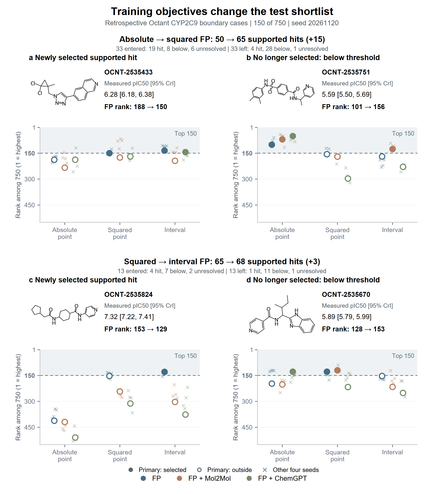

# Training objectives and the apparent value of molecular embeddings in CYP2C9 assay prioritization

Code and saved results for comparing training objectives and frozen molecular embeddings at a fixed assay budget.

## Run the checks

With Python 3.10 or later:

```sh
python verify_release.py
```

No extra packages, weights or network access are needed. This checks file hashes and runs:

- `reproducibility/`: Octant factorial, five-seed, endpoint/budget, archived-prediction and NCATS checks.
- `tox21/`: five seeds, three label rules and four budgets—540 shortlist cells, 1,200 paired contrasts and 60 sign-pattern decisions.

The checks use saved scores and labels. Model fitting, embedding extraction, raw-curve adjudication and scaffold resampling require the inputs and software listed in [analysis_source/](analysis_source/README.md) and [tox21/](tox21/README.md). They are not rerun by this command.

## Results

For the enriched 750-compound Octant catalogue, conventional fingerprints and descriptors (FP) recovered 50, 65 and 68 supported hits in 150 slots under absolute-point, squared-point and interval objectives. Interval-trained Mol2Mol and ChemGPT models recovered 57 and 60. Their +7/+10 differences against absolute-point FP became −11/−8 against interval FP. These observations apply to the fitted workflow and measured catalogue.

Tox21's initial decoder classified 0/482/3,946 candidates as supported hits/below threshold/unresolved; the corrected primary rule classified 17/2,668/1,743. The correction handles 15-position all-zero exclusion masks whose lengths differ from the visible doses. Non-activating records with mismatched nonzero masks provide no determinate evidence. The protocol file stayed unchanged; the adjudication code changed. Both versions failed the locally frozen criterion. They are two versions of one retrospective analysis, not independent replications or external preregistration.

At seed 20261120 and 885 slots, all 12 corrected comparisons under the primary, CYP-only and three-record rules had negative observed differences; every paired finite-panel bound crossed zero. This finding is specific to that seed and budget. Under the primary rule, the two absolute-point comparisons opposed the expected positive direction. The two negative same-interval comparisons matched the expected direction, but their bounds also included zero. These bounds vary unresolved outcomes; they are not 95% confidence intervals and do not establish equivalence.

The full NCATS and Tox21 catalogues leave the cross-catalogue effect uncertain. The results concern retrospective in vitro signal recovery, rather than prospective assay yield or clinical drug-interaction risk.

## Figure 2

[Code and source data](figures/fig2/) show four shortlist boundary cases across nine feature–objective configurations and five fitted seeds. In the complete FP lists at seed 20261120, absolute-to-squared training replaces 33 of 150 entries (19 supported hits enter, four leave); squared-to-interval training replaces 13 (four enter, one leaves). These give the observed net gains of 15 and three.

The four cases were selected post hoc, conditional on measured outcomes and proximity to the new FP selection boundary. They illustrate candidate-level changes and do not estimate average performance. Measured potency intervals and variation across fitted seeds are shown separately.

The directory includes the unchanged prediction and label tables, case selection, 180 plotted records, code, package versions, caption and figure files. To redraw, copy `figures/fig2/` to a working folder and follow its [README](figures/fig2/README.md). Plotting requires the listed packages; it is separate from the standard-library replay checks above and does not refit models.



## Files and checksums

Computer-specific paths and cache entries were removed from metadata, and the affected manifests were updated. Scores, labels and result tables are unchanged. Each `PUBLIC_DERIVATIVE.json` records the original checksums and the changes made for sharing. The edited locks differ from the preserved historical locks.

The Tox21 replay uses corrected labels. Initial-version records include summaries and quality-control results, but not a complete candidate-label table. `FILE_MANIFEST.csv` lists the release checksums. Raw assay exports and model weights are not included; their source links, versions and checksums are documented in the analysis directories.

## Data and license

Data: [OpenADMET CYP](https://doi.org/10.57967/hf/11464), [PXR](https://doi.org/10.57967/hf/9731), [NCATS AID 1645842](https://pubchem.ncbi.nlm.nih.gov/bioassay/1645842), [Tox21 CYP2C9 AID 1671198](https://pubchem.ncbi.nlm.nih.gov/bioassay/1671198) and the [firefly luciferase counterscreen AID 1224835](https://pubchem.ncbi.nlm.nih.gov/bioassay/1224835).

Code is available under the [MIT license](LICENSE). Source data, participant predictions, model weights and upstream software retain their own licenses.
